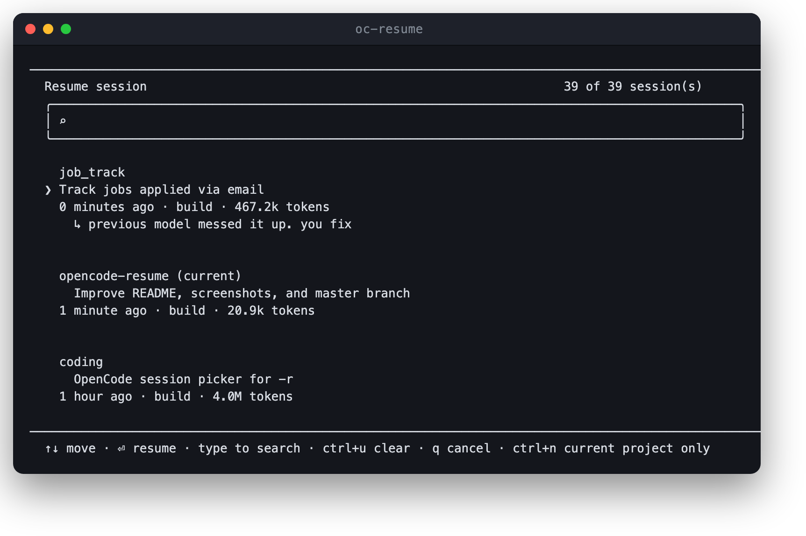
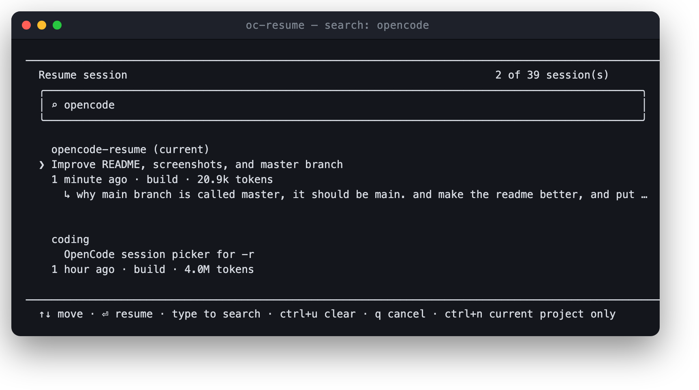

# oc-resume

A session picker for [OpenCode](https://opencode.ai).

Claude Code has `claude --resume`. OpenCode ships only `-c/--continue` (most
recent) and `-s/--session <id>` (an id you have to already know). This adds the
missing middle step: **pick one from a list.**

```sh
opencode -r          # or: oc-resume
```



Type to filter by title, last message, id, agent or model:



## Install

```sh
git clone https://github.com/omerdikyol/opencode-resume
cd opencode-resume
./install.sh
```

Requires **zsh** and **sqlite3** — both preinstalled on macOS, on Debian/Ubuntu
`apt install zsh sqlite3`. No build step, no runtime, no dependencies.

Then either run `oc-resume` directly, or also get `opencode -r`:

```sh
ln -s ~/.local/bin/oc-resume ~/.local/bin/opencode
```

`~/.local/bin` must come **before** opencode's own `bin` directory in `PATH`,
otherwise the real binary wins and `-r` is unknown to it. Reload your shell
afterwards (`exec $SHELL`).

## Keys

| Key | Action |
|---|---|
| `↑` `↓` | move |
| `Enter` | resume the selected session |
| type | filter by title, last message, id, agent or model |
| `backspace` | delete a filter character |
| `ctrl+u` | clear the filter |
| `Home` / `End` | first / last session |
| `ctrl+a` | toggle between this directory and all projects |
| `ctrl+n` | back to this directory only |
| `q` | cancel (while the filter is empty) |
| `ctrl+c` / `ctrl+d` | cancel |

Without a TTY (pipes, CI, scripts) it prints a numbered list and reads a choice,
so `printf '2\n' | oc-resume` works.

## Version and compatibility

oc-resume reads opencode's private schema, so each release is pinned to the
opencode build it was developed on:

```console
$ oc-resume --version
oc-resume 1.0.0 (2026-10-08)
  developed against : opencode v2.0.24
  installed opencode: v2.0.24
  database          : /Users/you/.local/share/opencode/opencode.db
  schema            : ok (session_v2, session_message)
```

- **developed against** — the opencode version this release was built and tested
  on. It lives in the `OC_RESUME_OPENCODE` constant in [`oc-resume`](oc-resume)
  and is bumped when an opencode release moves the `session_v2` /
  `session_message` schema.
- **installed opencode** — what you actually have. `untested with this release`
  is a warning, not an error; it usually still works.
- **schema** — a live, read-only check that the tables this script reads still
  exist. If opencode migrates them away, you get a message instead of a picker
  that silently lists nothing.

Worth running after you upgrade opencode, and useful in a bug report.

## Why it reads the database directly

Sessions live in opencode's SQLite store (`~/.local/share/opencode/opencode.db`
on macOS, `$XDG_DATA_HOME/opencode/opencode.db` on Linux). Reading it directly
is ~40× faster than asking the HTTP API and, more importantly, **correct**:

- `GET /api/session` returns the **50 most recently updated sessions across all
  projects**, unscoped, and the TUI picker filters that client-side. Any session
  older than the newest 50 machine-wide is unreachable. See
  [opencode#48974](https://github.com/anomalyco/opencode/issues/48974).
- `session.message.list` truncates large responses — Bun's `keepAliveTimeout`
  cuts the body mid-stream ([opencode#50507](https://github.com/anomalyco/opencode/pull/50507)) —
  so the last message can come back empty for big sessions.

Querying SQLite gives exact directory scoping and no truncation.

## Configuration

| Variable | Purpose |
|---|---|
| `OPENCODE_DB` | path to `opencode.db` (auto-detected otherwise) |
| `OPENCODE_REAL_BIN` | path to the real `opencode` binary (auto-detected otherwise) |
| `INSTALL_DIR` | install target for `install.sh`, default `~/.local/bin` |
| `NO_COLOR` | disable colour |

## Caveats

- Reads a **private schema** (`session_v2`, `session_message`). An opencode
  migration that renames those will break it; it fails with a clear message
  rather than silently. Recovery: `opencode session list`, then
  `opencode -s <id>`.
- Git **branch is not stored per session** in opencode's schema, so it is not
  shown.
- Sessions are matched to a directory by exact path, so sessions started in
  `~/proj/app` are not listed from `~/proj`. Use `ctrl+a` to see everything.
- macOS/Linux only: it is a zsh script and needs `sqlite3`.

## License

MIT